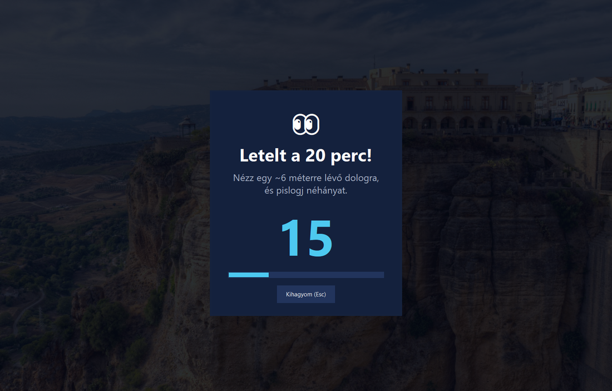
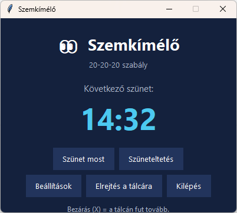
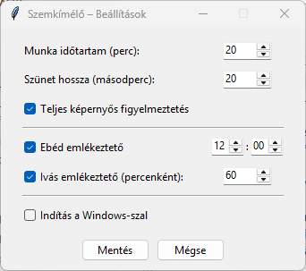
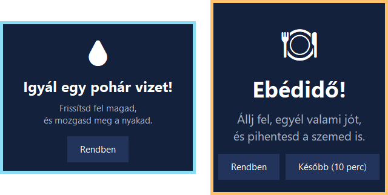
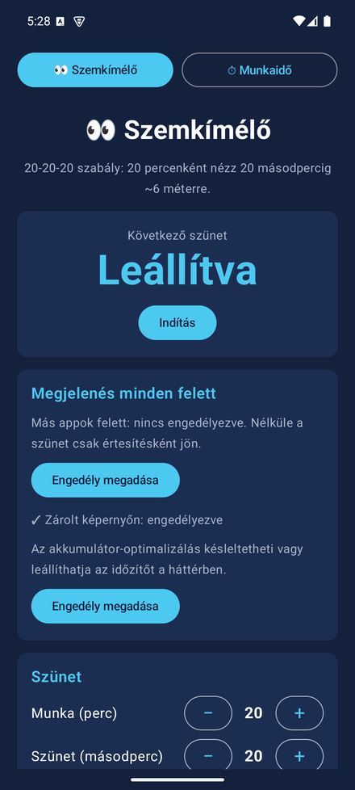
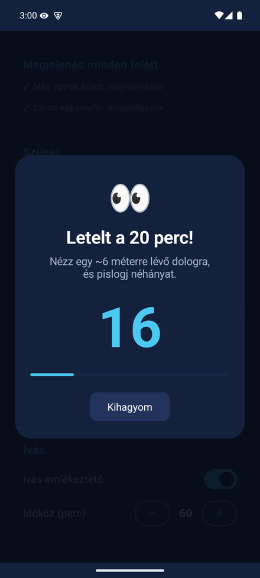
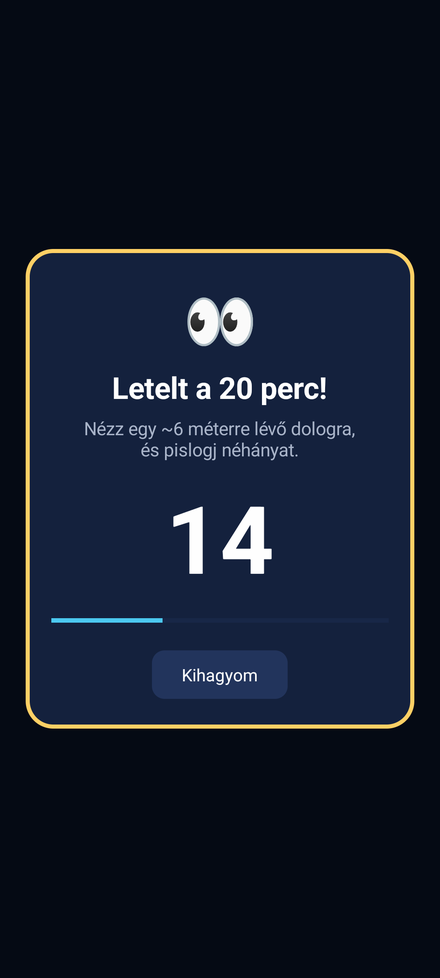

# 👀 Szemkímélő

**A 20-20-20 szabály emlékeztetője Windowsra és Androidra.**

> Minden **20 percben** nézz **20 másodpercig** egy kb. **20 láb (~6 méter)** távolságra lévő dologra.

A hosszú képernyőzés elfárasztja a szemet: közelre fókuszálva ritkábban pislogunk, és az izmok folyamatosan
feszülnek. Ez a rövid szünet segít pihentetni őket. A Szemkímélő ezt figyeli helyetted: ha letelt a
20 perc, feltűnő, **de hang nélküli** (Windowson) figyelmeztetéssel szól, és számolja a 20 másodpercet.
Mellé ebéd- és vízivás-emlékeztetőt is ad.



## Letöltés

| Platform | Letöltés | Mit kell tudni |
|---|---|---|
| 🪟 **Windows** | [Szemkimelo.exe – v1.1.2](https://github.com/szobek/szemkimelo/releases/tag/v1.1.2) | Önállóan fut, Python nem kell hozzá |
| 🤖 **Android** | [Szemkimelo-android.apk – v1.0.2](https://github.com/szobek/szemkimelo/releases/tag/android-v1.0.2) | Android 8.0 vagy újabb, oldaltöltéssel telepíthető |

Az app **nem használ internetet**, nem gyűjt és nem küld adatot. A Windowsos változat beállításai egyetlen
helyi fájlban vannak, az Androidos az app saját tárolójában.

---

## 🪟 Windows

### Funkciók

- **Szünet-figyelmeztetés** a 20 perc leteltekor: sötétített képernyő (minden monitoron), nagy
  visszaszámláló, folyamatjelző és pulzáló keret. Hangot nem ad, hogy ne zavarjon másokat sem.
- A szünet kihagyható (`Esc` vagy a `Kihagyom` gomb).
- **Ebéd emlékeztető** beállítható időponttal. Naponta egyszer jelenik meg, a megadott időponttól számított
  30 percen belül, és elhalasztható 10 percre.
- **Ivás emlékeztető** óránként (15–240 perc között állítható): kis ablak a jobb alsó sarokban, ami magától
  eltűnik.
- **Okos időzítő:** ha 5 percnél tovább nem érintetted a gépet, az már pihenésnek számít, ezért az időzítő
  újraindul. Az ivás emlékeztető is csak akkor jön, ha éppen a gépnél vagy.
- **Tálcaikon** a hátralévő idővel és menüvel: megnyitás, szünet most, szüneteltetés, időzítő újraindítása,
  beállítások, kilépés.
- Indítás a Windows-szal (kikapcsolható), ilyenkor csak a tálcán jelenik meg.
- Egyszerre egy példány fut: az exe újraindítása előhozza a már futó ablakot.

### Képek

<table>
<tr>
<td align="center"><b>Főablak</b><br></td>
<td align="center"><b>Beállítások</b><br></td>
</tr>
</table>

<p align="center"><b>Ivás és ebéd emlékeztető</b><br></p>

### Használat

1. Töltsd le a `Szemkimelo.exe` fájlt a [Releases](https://github.com/szobek/szemkimelo/releases) oldalról.
2. Indítsd el. Megnyílik a főablak, és a tálcán megjelenik az ikon.
3. A főablak bezárása (`X`) nem lépteti ki az appot, az a tálcán fut tovább. Kilépni a `Kilépés` gombbal vagy a
   tálcaikon menüjéből lehet.
4. Ha azt szeretnéd, hogy az app a gép indulásakor magától elinduljon, a `Beállítások` között kapcsold be az
   `Indítás a Windows-szal` opciót.

> **Megjegyzés:** az exe nincs digitálisan aláírva, ezért a Windows SmartScreen az első indításkor
> figyelmeztethet. A `További információ`, majd a `Futtatás mindenképp` gombbal indítható.
> Ha nem bízol az exe-ben, a forráskódból is futtathatod (lásd lent).

### Beállítások

| Beállítás | Alapérték | Megjegyzés |
|---|---|---|
| Munka időtartam | 20 perc | |
| Szünet hossza | 20 másodperc | |
| Teljes képernyős figyelmeztetés | be | Kikapcsolva csak a kártya jelenik meg, a sötétítés nélkül |
| Ebéd emlékeztető | be, 12:00 | Az időpont szabadon állítható |
| Ivás emlékeztető | be, 60 percenként | 15–240 perc között |
| Indítás a Windows-szal | ki | |

A beállítások a `%APPDATA%\Szemkimelo\config.json` fájlban vannak.

### Futtatás forrásból

Követelmény: Windows, Python 3.10 vagy újabb.

```powershell
pip install -r requirements.txt
python szemkimelo.py
```

Kapcsolók: `--background` (induláskor csak a tálcára kerül, főablak nélkül).

### Exe készítése

```powershell
python -m PyInstaller --noconfirm --onefile --windowed --name Szemkimelo szemkimelo.py
```

Az eredmény: `dist\Szemkimelo.exe`.

---

## 🤖 Android

Natív Kotlin + Jetpack Compose app, ugyanazokkal az alapfunkciókkal. Részletek, engedélyek és a fejlesztési
útmutató: [android/README.md](android/README.md).

<table>
<tr>
<td align="center"><b>Főképernyő</b><br></td>
<td align="center"><b>Szünet</b><br></td>
<td align="center"><b>Zárolt képernyőn</b><br></td>
</tr>
</table>

- 20 percenként teljes képernyős visszaszámláló jelenik meg más appok felett, **zárolt képernyőn is**.
- Hangjelzés és rezgés (külön kapcsolható), ivás és ebéd emlékeztető értesítésként.
- Újraindítás után az emlékeztetők maguktól folytatódnak.

### Telepítés

1. Töltsd le az APK-t a [Releases](https://github.com/szobek/szemkimelo/releases/tag/android-v1.0.2) oldalról. Ha az 1.0.1-es vagy régebbi
   verzió van fent, előbb töröld le (a v1.0.2-től az APK saját, állandó kulccsal van aláírva, ezért ez egyszer
   szükséges; a későbbi frissítések már a telepített fölé kerülnek).
2. Nyisd meg, és engedélyezd az ismeretlen forrásból való telepítést.
3. Ha a Google Play Protect `Kártékony alkalmazás letiltva` figyelmeztetést ad, koppints a **`Telepítés mégis`**
   lehetőségre. Ez téves riasztás: az app nem szerepel a Play Áruházban, és nem a Google által ismert
   kulccsal van aláírva. A kód nyílt, az app nem használ internetet és nem gyűjt adatot.
4. Indítsd el, nyomd meg az `Indítás` gombot, és add meg a kért engedélyeket.
5. **Kapcsold ki az akkumulátor-optimalizálást is** (a főképernyőn az `Engedély megadása` gomb az utolsó
   engedélysornál). Ez nélkül a telefon késleltetheti vagy leállíthatja az időzítőt, és a szünet nem jelenik
   meg megbízhatóan.

---

## ❓ Gyakori kérdések

**Miért pont 20-20-20?**
Ez egy egyszerű, szemorvosok által is ajánlott szabály a digitális szemfáradtság ellen. A 20 másodperces
távolba nézés alatt a szemizmok ellazulnak, és közben pislogni is érdemes.

**Kell hozzá Python?**
Az exe-hez nem. Python csak akkor kell, ha a forráskódból futtatod.

**Nem jelent meg a szünet-ablak. Miért?**
Ha 5 percnél tovább nem használtad a gépet, az időzítő újraindul. Ez szándékos, mert az már pihenésnek számít.

**Hová menti a Windowsos app a beállításokat?**
A `%APPDATA%\Szemkimelo\config.json` fájlba. Ennek törlésével visszaáll az alapállapot.

**Hogyan lehet teljesen eltávolítani a Windowsos appot?**
Kapcsold ki az `Indítás a Windows-szal` opciót, lépj ki az appból, majd töröld az exe-t és a
`%APPDATA%\Szemkimelo` mappát.

**Az Android telepítésnél „Kártékony alkalmazás letiltva” üzenetet kapok. Mit tegyek?**
Koppints a `Telepítés mégis` lehetőségre. A Play Protect téves riasztása, mert az app nincs a Play Áruházban.

**Az Androidos szünet néha nem jelenik meg. Miért?**
Valószínűleg az akkumulátor-optimalizálás késlelteti vagy leállítja az időzítőt. Kapcsold ki az app számára a
főképernyőn lévő `Engedély megadása` gombbal.

**Miért nem jelenik meg az Android szünet a lezárt képernyő felett?**
Android 14-től a `Teljes képernyős értesítések` engedélyt kézzel kell megadni. Az app a főképernyőn jelzi, ha
hiányzik, és a megfelelő beállításhoz visz.

## Hibabejelentés, ötlet

Ha hibát találsz, vagy van ötleted, nyiss egy [issue-t](https://github.com/szobek/szemkimelo/issues), vagy
küldj pull requestet.

## Kiadások készítése

A kiadásokat a GitHub Actions építi, a címke (tag) neve dönti el, mi készül:

| Címke | Eredmény |
|---|---|
| `v1.2.3` | Windowsos `Szemkimelo.exe` a release-hez csatolva |
| `android-v1.2.3` | aláírt Androidos APK a release-hez csatolva |

```powershell
git tag v1.2.3
git push origin v1.2.3
```

Az Androidos aláíráshoz négy titok kell a repó beállításaiban (`Settings → Secrets and variables → Actions`):
`ANDROID_KEYSTORE_BASE64`, `ANDROID_KEYSTORE_PASSWORD`, `ANDROID_KEY_ALIAS`, `ANDROID_KEY_PASSWORD`.
Helyi buildhez az `android/keystore.properties` fájl kell (`storeFile`, `storePassword`, `keyAlias`,
`keyPassword`); ez és a kulcsfájl nincs a repóban. Kulcs nélkül a build a debug kulccsal ír alá.

## Mappaszerkezet

```
szemkimelo.py      A Windowsos app (Python + tkinter)
requirements.txt   Windowsos függőségek
android/           Az Androidos app (Kotlin + Compose)
docs/images/       A README képei
.github/workflows/ Automatikus kiadás-készítés
```

## Licenc

[MIT](LICENSE): szabadon használhatod, módosíthatod és terjesztheted.
