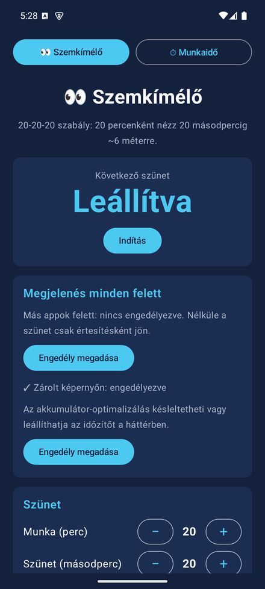
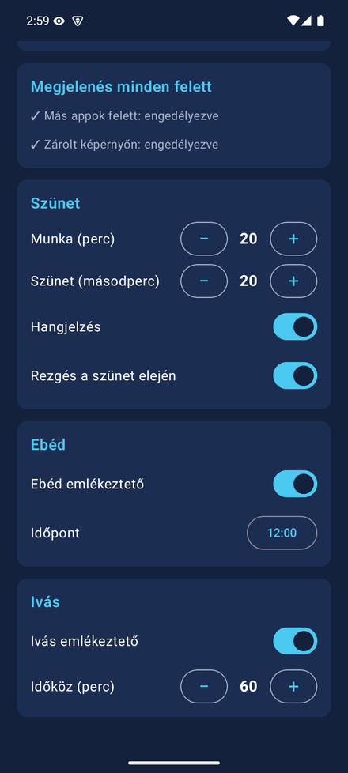
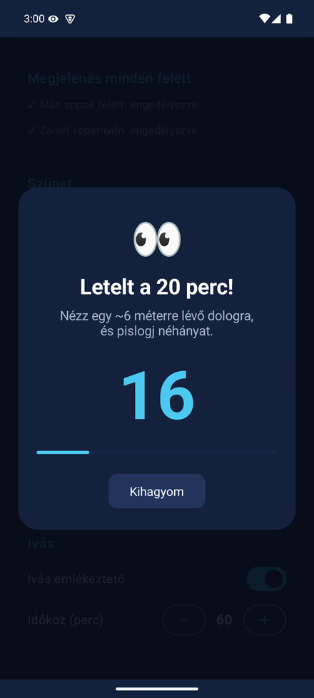
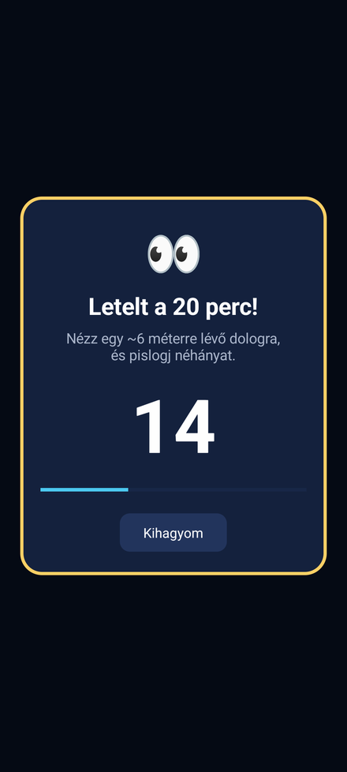
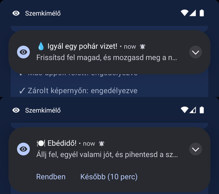

# Szemkímélő – Android

A [Szemkímélő](../README.md) Android változata: a **20-20-20 szabály** emlékeztetője, ebéd- és
vízivás-emlékeztetővel. Natív Kotlin + Jetpack Compose app.

<table>
<tr>
<td align="center"><b>Főképernyő</b><br></td>
<td align="center"><b>Beállítások</b><br></td>
<td align="center"><b>Szünet</b><br></td>
</tr>
<tr>
<td align="center"><b>Szünet zárolt képernyőn</b><br></td>
<td align="center" colspan="2"><b>Ivás és ebéd emlékeztető</b><br></td>
</tr>
</table>

## Funkciók

- **20-20-20 szünet:** 20 percenként (állítható) teljes képernyős visszaszámláló jelenik meg más appok
  felett: nagy számláló, folyamatjelző, pulzáló keret, `Kihagyom` gomb. A szünet végén az időzítő magától
  újraindul.
- **Zárolt képernyőn is megjelenik:** a telefon felébred, és a visszaszámláló a lezárási képernyő felett látszik.
- **Hangjelzés** (a telefon értesítési hangja) és opcionális **rezgés** a szünet elején és az emlékeztetőknél.
  Mindkettő külön kapcsolható az appban.
- **Ivás emlékeztető** óránként (az időköz 15–240 perc között állítható), felugró értesítésként.
- **Ebéd emlékeztető** beállítható időponttal, napi egyszer. Az értesítésről elhalasztható 10 percre.
- A `+` / `−` gombok nyomva tartva folyamatosan (egyre gyorsabban) változtatják az értéket.
- A beállítások módosítása után az időzítés magától frissül, nem kell újraindítani az appot.
- Újraindítás után az emlékeztetők maguktól folytatódnak.
- A futást egy állandó értesítés jelzi, amin a `Szünet most` és a `Leállítás` művelet is elérhető.
- Nincs internet-hozzáférés, nincs adatgyűjtés.

## Telepítés (APK)

1. Töltsd le az `.apk` fájlt a [Releases](https://github.com/szobek/szemkimelo/releases/tag/android-v1.0.1)
   oldalról.
2. Nyisd meg a telefonon, és engedélyezd az ismeretlen forrásból való telepítést.
3. Ha a Google Play Protect `Kártékony alkalmazás letiltva` figyelmeztetést ad, koppints a **`Telepítés mégis`**
   lehetőségre (lásd lent).
4. Indítsd el az appot, nyomd meg az `Indítás` gombot, és add meg a kért engedélyeket.
5. **Fontos:** a főképernyőn kapcsold ki az akkumulátor-optimalizálást is (`Engedély megadása` az utolsó
   engedélysornál). Ez nélkül a telefon késleltetheti vagy leállíthatja az időzítőt a háttérben, és a szünet
   nem jelenik meg megbízhatóan.

Követelmény: Android 8.0 (API 26) vagy újabb.

### Play Protect figyelmeztetés

Az app nincs a Play Áruházban, és az APK nem a Google által ismert fejlesztői kulccsal van aláírva, ezért a
Play Protect ismeretlen alkalmazásként kezeli, és a kért érzékeny engedélyek (megjelenés más appok felett,
teljes képernyős értesítés, pontos ébresztő) miatt figyelmeztethet. Ez téves riasztás: az app nyílt
forráskódú, nem használ internetet, és nem gyűjt adatot. Telepíteni a **`Telepítés mégis`** lehetőséggel lehet.
Ha ez nem jelenik meg, kapcsold ki ideiglenesen az `Alkalmazások vizsgálata a Play Protecttel` beállítást
(Play Áruház → profilkép → Play Protect → fogaskerék), telepítsd az appot, és utána kapcsold vissza.

## Engedélyek

| Engedély | Mire kell |
|---|---|
| Értesítések | ivás és ebéd emlékeztető, a futás jelzése |
| Megjelenítés más appok felett | teljes képernyős visszaszámláló használat közben (nélküle csak értesítést kapsz) |
| Teljes képernyős értesítések | a visszaszámláló zárolt képernyő felett (Android 14+: kézzel kell engedélyezni, az app jelzi) |
| Akkumulátor-optimalizálás kikapcsolása | az időzítő ne késsen és ne álljon le a háttérben (**a megbízható megjelenéshez kell**, az app jelzi) |
| Pontos ébresztők | az emlékeztetők pontos időzítése (automatikusan megkapja) |
| Előtér-szolgáltatás | az időzítő folyamatos futása a háttérben |
| Indítás újraindítás után | az emlékeztetők folytatása a telefon újraindítása után |
| Rezgés | opcionális rezgés a szünet elején |

A főképernyő `Megjelenés minden felett` kártyája mutatja, hogy a két megjelenítési engedély megvan-e, és
egy koppintással a megfelelő rendszerbeállításhoz visz.

## Hogyan működik?

- Az időzítést a rendszer pontos ébresztői (`AlarmManager`) végzik, egy előtér-szolgáltatás (`ReminderService`)
  kezeli az eseményeket, ezért az app a háttérben is megbízhatóan működik.
- Használat közben a szünetet egy `TYPE_APPLICATION_OVERLAY` ablak mutatja. Ez az Android szabályai szerint
  nem takarhatja le az állapotsort.
- Zárolt képernyőn teljes képernyős értesítés indít egy külön `BreakActivity`-t, ami a lezárási képernyő
  felett jelenik meg, és bekapcsolja a kijelzőt.
- Az overlay mellé minden szünetnél felugró értesítés is érkezik. Egyes appok ugyanis elrejtik a más appok
  feletti ablakokat, amíg előtérben vannak (például a rendszerbeállítások). Az értesítés ilyenkor is látszik,
  és rákoppintva teljes képernyős szünet-képernyő nyílik meg.
- Ha az engedélyek hiányoznak, az app csak értesítésre vált vissza (visszaszámlálás nélkül).

## Hibakeresés

Ha a szünet nem jelenik meg, vagy késik:

1. A főképernyőn a `Teszt: szünet 10 mp múlva` gombbal ki lehet próbálni az ébresztést: nyomd meg, és válts
   át másik appra.
2. A főképernyő alján látszik az **utolsó szünet** indulási ideje, a **késése** a tervezetthez képest, és hogy
   hogyan jelent meg (`overlay + értesítés` vagy `csak értesítés`).
3. Ellenőrizd, hogy a `Megjelenés minden felett` kártyán minden pipa zöld, és az akkumulátor-optimalizálás
   ki van kapcsolva.
4. Egyes gyártók (Xiaomi, Huawei, Samsung, OnePlus) külön engedélyt kérnek az automatikus indításhoz és a
   háttérben futáshoz. Ezt a telefon beállításaiban kell megadni.

## Ismert korlátok

- Az app erőltetett leállítása (`Kényszerített leállítás` a rendszerbeállításokban) törli az ébresztőket.
  Ilyenkor nyisd meg újra az appot, és nyomd meg az `Indítás` gombot.
- Egyes gyártók (pl. Xiaomi, Huawei, Samsung) agresszíven leállítják a háttérfolyamatokat. Ilyenkor érdemes az
  appot kivenni az akkumulátor-optimalizálásból.
- A release APK jelenleg a debug kulccsal van aláírva, ami oldaltöltéshez (sideload) elég. Play Áruházhoz külön
  feltöltési kulcs kellene.

## Fejlesztés

Követelmény: JDK 17, Android SDK (platform 35).

```powershell
cd android
.\gradlew.bat assembleDebug      # app\build\outputs\apk\debug\app-debug.apk
.\gradlew.bat assembleRelease    # app\build\outputs\apk\release\app-release.apk
```

A `local.properties` fájlban kell megadni az SDK helyét (`sdk.dir=...`); ez nincs a repóban.

### Felépítés

| Fájl | Szerepe |
|---|---|
| `MainActivity.kt` | a Compose felület: állapot, beállítások, engedélykezelés |
| `ReminderService.kt` | előtér-szolgáltatás: a szünet, az ivás és az ebéd eseményei |
| `Scheduler.kt` | az ébresztők beállítása és törlése |
| `Notifications.kt` | értesítési csatornák és értesítések |
| `BreakOverlay.kt` | a szünet-képernyő tartalma és az overlay ablak |
| `BreakActivity.kt` | a szünet-képernyő zárolt képernyő felett |
| `Prefs.kt` | a beállítások tárolása |
| `Receivers.kt` | ébresztő- és indítás utáni fogadók |
